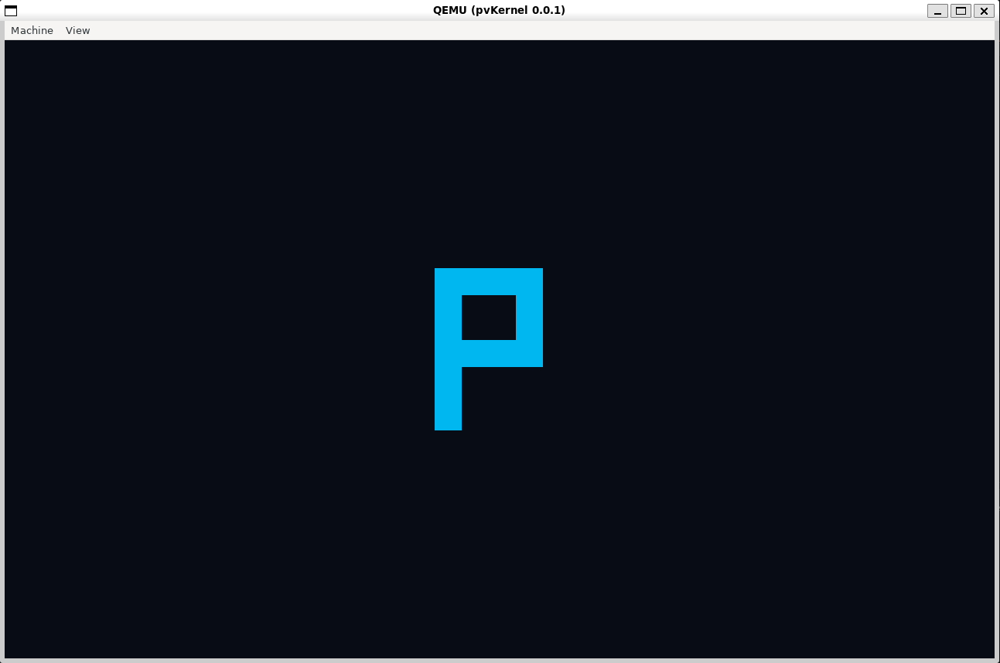

# pvKernel

pvKernel is an experimental open-source x86_64 operating system kernel
written in Rust and developed as the foundation of pvOS.

> [!WARNING]
> pvKernel is in a very early stage of development. It is not currently
> suitable for production use or as a general-purpose operating system kernel.



## Current milestone

Version: `0.0.5` — Virtual Memory Foundation

Implemented:

* UEFI boot
* x86_64 kernel entry point
* boot memory map access
* linear framebuffer access
* a kernel-owned Global Descriptor Table (GDT)
* a kernel-owned Task State Segment (TSS)
* a dedicated Interrupt Stack Table stack for double faults
* a kernel-owned Interrupt Descriptor Table (IDT)
* exception handlers for breakpoint, invalid opcode, general protection
  fault, page fault, and double fault
* a controlled breakpoint (`int3`) boot-time verification
* an optional page-fault test behind the `fault-tests` Cargo feature
* a legacy 8259 PIC driver (IRQ vector remapping, masking, EOI, spurious IRQ
  detection)
* a PIT channel 0 periodic timer with an atomic tick counter
* IDT handlers for all 16 remapped IRQ vectors, with a boot-time verification
  that maskable hardware interrupts are safely enabled and timer ticks are
  delivered
* a monotonic physical frame allocator built from the bootloader memory map
* safe, narrowly-scoped access to the active x86_64 page table
* 4 KiB map/unmap/permission-change/translate operations with a W^X
  permission model
* a boot-time memory smoke test and an optional post-unmap page-fault test
  behind the `mem-fault-tests` Cargo feature
* deterministic, headless QEMU tests behind the `qemu-test` Cargo feature
* structured serial diagnostics
* panic handler
* an interrupt-enabled idle loop (plus a separate fatal halt path)

Not implemented:

* APIC initialization
* keyboard or mouse input
* frame deallocation/reuse (the physical frame allocator is monotonic only)
* kernel heap or dynamic allocation
* guard pages
* processes, threads, or a scheduler
* user mode or system calls
* ELF userspace loading
* filesystems
* networking
* device drivers beyond serial, framebuffer, PIC, and PIT

pvKernel does not claim production readiness, general hardware support,
process isolation, a stable ABI, or readiness as a reusable kernel or pvOS
foundation.

## Build

```bash
cargo build
```

## Run

```bash
cargo run
```

## Run the optional page-fault test

Deliberately dereferences an unmapped virtual address to exercise the
page-fault handler (CR2, error flags, and stack frame diagnostics), then
halts. Disabled by default; the root workspace forwards the feature to the
kernel build:

```bash
cargo run --features fault-tests
```

See [docs/development/debugging.md](docs/development/debugging.md) for the
expected output.

## Run the optional post-unmap page-fault test

Maps a temporary page, writes and verifies a sentinel value, unmaps it, and
deliberately re-accesses it to exercise the page-fault handler's
not-present classification. Disabled by default:

```bash
cargo run --features mem-fault-tests
```

See [docs/development/memory-testing.md](docs/development/memory-testing.md)
for the expected output.

## Run the deterministic headless QEMU tests

Verifies PIC/PIT initialization, repeated timer interrupt delivery, and the
memory-mapping smoke test (and, with `fault-tests`/`mem-fault-tests` also
enabled, their respective expected page faults), then exits QEMU with a
pass/fail status instead of leaving a graphical window open:

```bash
cargo run --features qemu-test -- --headless-test
cargo run --features "qemu-test fault-tests" -- --headless-test
cargo run --features "qemu-test mem-fault-tests" -- --headless-test
```

See [docs/development/testing.md](docs/development/testing.md) for details.

## Current boot flow

```
UEFI firmware
    ↓
rust-osdev bootloader
    ↓
pvKernel ELF
    ↓
kernel_main
    ├── serial logging
    ├── boot memory map
    ├── x86_64 GDT, TSS and IDT
    ├── physical frame allocator + active page table
    ├── PIC remap + PIT configuration
    ├── memory-mapping smoke test
    ├── framebuffer
    ├── controlled breakpoint test
    ├── timer interrupt verification
    └── interrupt-enabled idle loop
```

The bootloader is currently responsible only for loading the kernel and
providing initial boot information. Kernel subsystems and operating-system
services are implemented by pvKernel itself. See
[ARCHITECTURE.md](ARCHITECTURE.md) for details.

## Documentation

* [ARCHITECTURE.md](ARCHITECTURE.md) — current kernel architecture
* [docs/architecture/boot.md](docs/architecture/boot.md) — boot flow
* [docs/architecture/interrupts.md](docs/architecture/interrupts.md) —
  IDT and exception handling
* [docs/architecture/hardware-interrupts.md](docs/architecture/hardware-interrupts.md) —
  legacy 8259 PIC driver
* [docs/architecture/timer.md](docs/architecture/timer.md) — PIT timer driver
* [docs/architecture/virtual-memory.md](docs/architecture/virtual-memory.md) —
  physical/virtual memory foundation
* [docs/development/build.md](docs/development/build.md) — build environment
* [docs/development/debugging.md](docs/development/debugging.md) —
  debugging and diagnostics
* [docs/development/testing.md](docs/development/testing.md) —
  deterministic headless QEMU tests
* [docs/development/memory-testing.md](docs/development/memory-testing.md) —
  memory subsystem boot-time tests
* [docs/dependencies.md](docs/dependencies.md) — direct dependency review
* [ROADMAP.md](ROADMAP.md) — planned milestones
* [CHANGELOG.md](CHANGELOG.md) — release history
* [CONTRIBUTING.md](CONTRIBUTING.md) — contribution guide
* [CODE_OF_CONDUCT.md](CODE_OF_CONDUCT.md) — community expectations
* [SECURITY.md](SECURITY.md) — security policy

## License

Licensed under either the MIT License or the Apache License 2.0,
at your option.

## Screenshot

